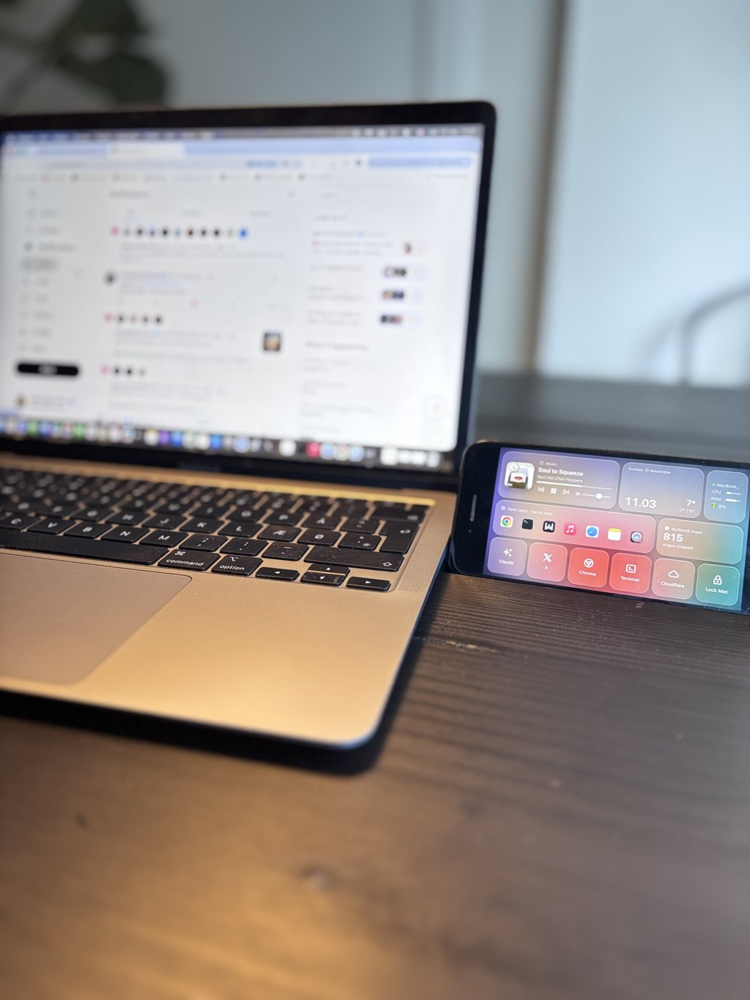
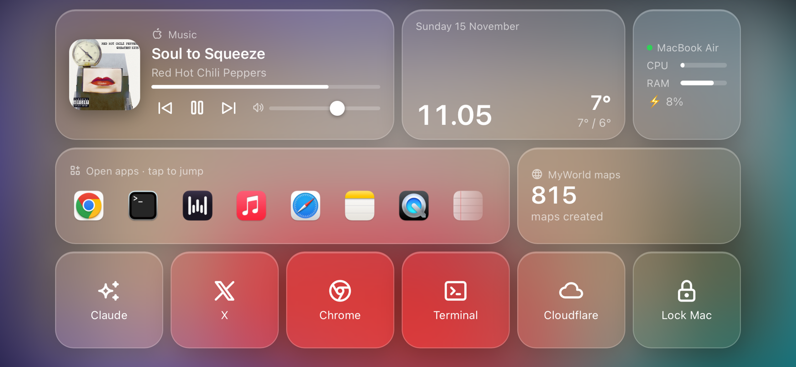

# iPhone Reemployment 📱

**Your old iPhone just got its job back.**

Give the phone collecting dust in your drawer a new job: a live dashboard and control panel that sits next to your Mac.





## What it does

- **Now playing:** song, album art, play/pause/skip and a volume slider (Spotify and Apple Music)
- **Open apps:** your most recent apps, tap one to jump straight to it
- **Mac stats:** live CPU, RAM and battery
- **Clock and weather** for your city
- **Counter tile:** any number you want to keep an eye on
- **6 shortcut buttons:** Claude, X, Chrome, Terminal, Cloudflare and Lock Mac, all easy to change

No app to install on the phone, no account, no cloud. A small script runs on your Mac, and the phone opens it like a website over your Wi-Fi.

## What you need

- A Mac with [Node.js](https://nodejs.org) 18 or newer (check with `node -v` in Terminal)
- Any old iPhone, iPad or Android phone with a browser, on the same Wi-Fi as the Mac

## Get started

```bash
git clone https://github.com/adammalherbe/iphone-reemployment.git
cd iphone-reemployment
node server.mjs
```

No `npm install` needed.

**Not using git?** Click the green **Code** button at the top of this page → **Download ZIP**. Unzip it, open Terminal in that folder and run `node server.mjs`.

The first time, a page with a QR code opens on your Mac. Scan it with the old phone, then:

1. Tap **Share → Add to Home Screen** and open it from the new icon (full screen, no Safari bar)
2. Turn the phone sideways
3. Set **Settings → Display & Brightness → Auto-Lock → Never** and keep the phone on a charger

Lost the QR page? Open `http://localhost:4242/pair` on the Mac, or type the link Terminal prints into the phone's browser.

## Mac permissions

The first time it reads your music or open apps, macOS asks if Terminal may control **Music**, **Spotify** or **System Events**. Click **Allow**.

If a tile stays empty, check **System Settings → Privacy & Security → Automation → Terminal** and turn them on.

## Make it yours

Everything you'd want to change is at the top of `server.mjs`:

```js
// Weather for your city
const WEATHER = { lat: 37.33, lon: -122.01 };

// The counter tile
const COUNTER = { label: "Counter", icon: "chart-line", sub: "tap to update" };

// The 6 buttons. Any shell command works.
const BUTTONS = [
  { id: "claude", label: "Claude", icon: "sparkles", cmd: `open -a Claude || open https://claude.ai` },
  { id: "deploy", label: "Deploy", icon: "rocket",   cmd: `cd ~/my-project && npm run deploy` },
  // …
];
```

Icons come from [Tabler Icons](https://tabler.io/icons). Use the name without `ti-`. Restart after changes (Ctrl + C, then `node server.mjs`) and reload the phone.

## Start it automatically

```bash
./scripts/autostart-on.sh    # start every time you log in
./scripts/autostart-off.sh   # turn that off again
```

In the background, macOS may ask for the permissions again, this time for **node**. Click **Allow**. The log is at `/tmp/iphone-reemployment.log`.

## Is it safe?

- It only listens on your home network, and every request needs the secret token in the link. Don't share that link.
- The token lives in the `.token` file. Delete it and restart to get a new one (then re-add the phone).
- Nothing leaves your Mac except the weather lookup ([Open-Meteo](https://open-meteo.com), no account, no key).
- Don't expose port 4242 to the internet.

## Troubleshooting

| Problem | Fix |
|---|---|
| Phone shows a different website | Safari dropped the `:4242` part. Type the full link, including the port and `?t=…` |
| "Open the link printed in Terminal" | The `?t=…` part is missing from the link |
| Music or apps tile is empty | Allow the Automation permissions above |
| No album cover in Apple Music | Some streamed songs don't store a cover on the Mac. Songs in your library do |
| "Port 4242 is already in use" | It's already running in another window. Or use `PORT=4343 node server.mjs` |
| Stops updating | The Mac went to sleep or the server was closed. Start it again |

## How it works

`server.mjs` is one Node file with zero dependencies. It reads your Mac's stats, music and open apps with built-in macOS tools (`osascript`, `lsappinfo`, `vm_stat`, `pmset`) and streams them to the phone with Server-Sent Events. `index.html` is the whole phone UI.

Built on a Sunday with [Claude](https://claude.ai).

## Contributing

Ideas, bugs and pull requests are welcome. Open an [issue](https://github.com/adammalherbe/iphone-reemployment/issues) and tell me what you'd add.

## License

[MIT](LICENSE). Use it, change it, share it. If you rehire your own iPhone, I'd love to see it.
